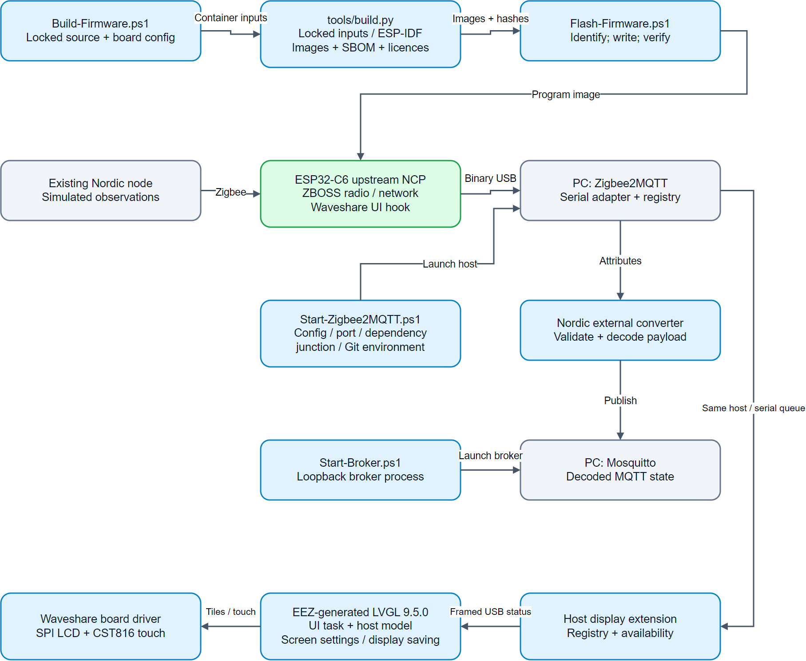

# ESP32-C6 coordinator firmware architecture

This describes the implemented USB coordinator and its Windows host. The radio protocol core comes from pinned `esp-coordinator` upstream. This branch owns the sole maintained Waveshare product build/flash wrappers, host launcher and status UI with a separate board driver. XIAO remains only in its historical Git tag.

[Editable draw.io source](assets/architecture.drawio). The diagram distinguishes the upstream NCP from project-owned integration code. Source paths below are relative to [the integration directory](https://github.com/Priyanshu0901/SustaintheSystem/tree/master/firmware/esp32c6_coordinator).

## Build and programming boundaries

`Build-Firmware.ps1` checks the locked upstream checkout and LVGL source archive, then launches the pinned Docker build. `tools/build.py` applies one active configuration, checks EEZ project/output provenance, copies UI/board components and the exact LVGL9.5.0 release, and applies the Waveshare startup/vendor-request hook. It exports images, a CycloneDX SBOM and licence notices with hashes. [SBOM operations and coverage](https://github.com/Priyanshu0901/SustaintheSystem/blob/POC/zigbee_coordinator_dev/waveshare/firmware/esp32c6_coordinator/SBOM.md) owns the dependency inventory. The upstream checkout stays clean; historical board selection is absent.

`Flash-Firmware.ps1` checks artifact identity and the selected ESP32-C6, then programs and verifies the image before boot. [Upstream and builds](Upstream%20and%20Builds.md) owns parent selection/build isolation; [active board](Board%20Profiles.md) owns GPIO and antenna settings. Exact commands and provenance remain in the operations guide.

## Runtime boundary

Nordic reports enter the ESP32-C6 over Zigbee. The upstream ZBOSS NCP handles the radio/network and exposes its binary serial protocol over USB. Zigbee2MQTT drives that adapter and applies the Nordic external converter. Mosquitto carries decoded MQTT state. The separate [status UI](Display%20UI.md) receives bounded host snapshots through the same serial queue; it does not calculate mesh membership or reachability from neighbor tables. No acoustic-monitoring dashboard is implemented here.

The [Nordic architecture](../Nordic%20Zigbee/Architecture.md) owns report production and callback behavior. [Report protocol](../Nordic%20Zigbee/Report%20Protocol.md) owns the payload definition, avoiding a second copy here.

## Existing host wrappers

`host/Install-Host.ps1` prepares pinned host dependencies. `host/Start-Broker.ps1` launches the loopback broker. `host/Start-Zigbee2MQTT.ps1` supplies the serial port, preserves runtime configuration, scopes Git discovery and supplies the dependency junction used by converter reloads. It leaves installed package source unchanged.

[Host integration](Host%20Integration.md) owns state/restart semantics. [Code reference](Code%20Reference.md) maps project scripts. [Firmware operations](https://github.com/Priyanshu0901/SustaintheSystem/tree/master/firmware/esp32c6_coordinator) owns setup, addresses and measured results; no new build or hardware test is implied by this documentation.
