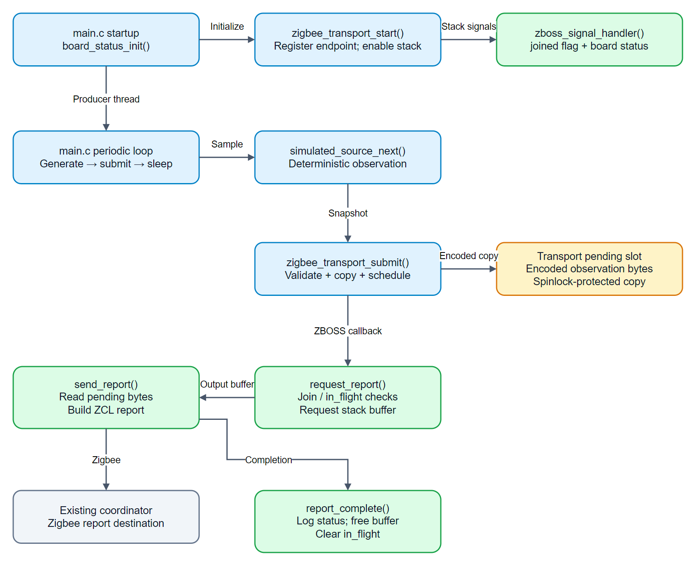

# Nordic Zigbee firmware architecture

This describes the existing `firmware/nordic_zigbee` application: a deterministic simulated-observation producer, portable encoder, ZBOSS transport and optional board indicator. The code is a Zigbee transport test; it does not acquire audio or run acoustic inference.

[Editable draw.io source](assets/architecture.drawio). Function names match the current implementation. Source paths below are relative to [the firmware directory](https://github.com/Priyanshu0901/SustaintheSystem/tree/master/firmware/nordic_zigbee); local files may precede publication.

## Startup and producer thread

`src/main.c` initializes `board_status`, stops on an initialization error, then calls `zigbee_transport_start()`. The transport registers its endpoint, applies the selected sleepy-role behavior and enables Zigbee with its normal persisted network state.

The main thread periodically calls `simulated_source_next()` and submits the resulting snapshot. `src/simulated_source.c` owns the generated sequence, scores and rotating direction; all records carry the simulated flag. Generation continues even when a report cannot be queued. The configured report interval controls the thread's sleep between submissions.

## Encoding and thread handoff

`zigbee_transport_submit()` calls the portable encoder in `src/observation.c`, rejects invalid snapshots or an unjoined state, copies accepted bytes into one spinlock-protected pending slot and schedules `request_report()` in ZBOSS context. The caller's pointer is never retained. A scheduling failure can occur after the slot has been updated.

This is a latest-value slot. Submissions can coalesce, and a successful submit does not prove delivery. There is no offline queue or application acknowledgement. The next producer submission provides another scheduling opportunity after buffer or scheduler pressure.

## ZBOSS callbacks and buffer ownership

`request_report()` checks join state and `in_flight`, then requests an outgoing stack buffer. `send_report()` copies the current pending bytes, constructs the ZCL Attribute Report and sends it to the coordinator. A join-state change or immediate rejection clears `in_flight` and frees the buffer; `report_complete()` handles completion logging and buffer release after an accepted send.

Only ZBOSS callbacks operate on packet buffers and `in_flight`. `zboss_signal_handler()` delegates normal stack signals, updates the atomic joined state, calls the board indicator and releases its signal buffer. The shared pending slot uses a spinlock; the portable observation model has no Zephyr or Zigbee dependency.

## Board component and contracts

`src/board_status.c` selects device-tree PWM indicators when enabled, or no-op functions when disabled. It changes the blue/green indication from join state and makes no network decisions. [Board profiles](Board%20Profiles.md) owns pin/profile choices.

[Report protocol](Report%20Protocol.md) owns endpoint identifiers, wire layout and units. [Code reference](Code%20Reference.md) points to API contracts. [Firmware operations](https://github.com/Priyanshu0901/SustaintheSystem/tree/master/firmware/nordic_zigbee) owns commands and measured validation; authored router/DK profiles do not imply corresponding hardware tests.
