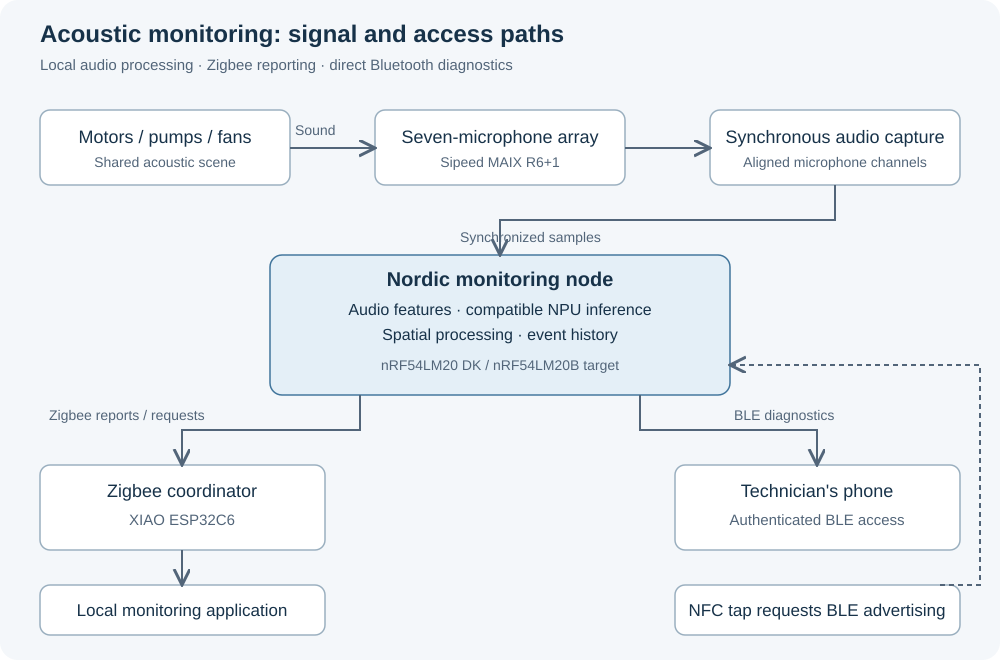

# Story

[Hackster Story editor](https://www.hackster.io/projects/0ce81d/edit#story) · [[Hackster/Basics|Basics]] · [[Hackster/Things|Things]]

Only the text between the article markers is intended for Hackster's Story section. Project overview: [[Overview]].

<!-- BEGIN HACKSTER ARTICLE -->

A motor that sounds different is worth paying attention to. Picking it out while a pump, two fans and everything else in the room are running is another matter. A microphone hears the whole room; an operator needs to know which machine to inspect.

I’m building a non-contact acoustic monitor for that situation. It will sit near rotating machinery, detect changes in operating sound and associate those changes with a source direction. The microphone array supplies spatial information, and an embedded model looks for departures from normal operation.

Vibration and temperature sensors already do useful work in condition monitoring. They usually require installation on individual machines. Here, I’m using sound to monitor from a nearby position, with the aim of helping an operator identify equipment that needs inspection before a small problem becomes a reason to replace it.

> **Image to add:** A workshop or plant-room photograph showing several nearby motors, pumps or fans. Use an image where their shared acoustic space is obvious, and credit the source.

The monitoring node is built around the Nordic nRF54LM20 DK, targeting the nRF54LM20B and its Axon Neural Processing Unit (NPU). Audio processing and inference will run locally. Zigbee will carry reports to a local monitoring application, while Bluetooth Low Energy (BLE) will provide direct access during maintenance.

Each node will store event times, anomaly scores, operating-state information and direction estimates. Sending those observations instead of a continuous audio stream keeps the network traffic small and leaves the acoustic processing independent of the monitoring application. If the application disconnects, the node will continue collecting observations for later retrieval.

## Microphone Array and Audio Capture

I’m using the Sipeed MAIX R6+1 seven-microphone array to capture the same acoustic scene from different positions. The relative timing between those channels is essential: direction estimation depends on differences in the signals, not just seven recordings of roughly the same moment.

The acquisition path will capture the channels together and preserve their alignment as samples move into the Nordic processing pipeline. I’ll check channel timing and sustained throughput before using the recordings for spatial analysis. A direction estimate is not useful if the capture system has introduced the delay it is trying to measure.

> **Image to add:** A top-down photograph or drawing of the R6+1 array with microphone positions labelled. Beside it, show a wave arriving from one side and reaching the microphones at different times. This is an explanatory sketch, so label it as an illustration rather than a measurement.

For spatial processing, I’ll use delay-and-sum beamforming to emphasize sound from a selected direction and evaluate time-difference-of-arrival estimates using GCC-PHAT to calculate delays between channels.

I’ll compare two processing arrangements. The first forms directional audio before running the anomaly model. The second detects a change in mixed audio and then examines the spatial information associated with it. The comparison will use correct-machine association and processing cost as well as angular error. Finding the loudest fan is not necessarily finding the abnormal one.

Reflections complicate this because the same sound reaches the array along more than one path. Nearby machines also share parts of the frequency spectrum. The output will therefore identify a likely direction or associate the event with a known machine position; the first implementation will not attempt precise room coordinates.

## Acoustic Anomaly Detection

The model will learn normal operating sound and produce an anomaly score when an observation differs from it. Starting with normal operation avoids requiring a labelled recording of every fault the equipment might develop.

I’ll begin with spectral analysis and log-mel spectrograms, using FFT and short-time Fourier processing to examine how the signal changes over time. Compact autoencoders will provide the initial model baseline. Feature extraction and inference will be measured together, since a small network does not guarantee a small processing workload.

MIMII and DCASE machinery recordings will provide the first offline training and evaluation data. I’ll keep recordings for training, threshold selection and testing separate, and record the dataset version and operating conditions with the results. Physical recordings from the test setup will then show how the model behaves with this array and these machines.

Training and quantization will run on a computer. I’ll deploy the quantized model to the Nordic device and check operator support, model size, RAM and inference time alongside its detection performance. Acquisition, feature extraction, storage and communication must all fit around that workload.

An anomaly score is a reason to inspect, not a diagnosis of bearing damage. Changes in speed, load and background noise also change the recording. Those normal variations will be included in testing so that a different operating condition does not automatically become a maintenance alert.

> **Image to add after recording:** Normal and abnormal spectrograms with identical axes and colour scales. Include the machine condition, speed and microphone position in the caption. Use the actual recordings from the tests.

## Wireless Monitoring and Diagnostics

The XIAO ESP32C6 will coordinate the Zigbee network and connect to the monitoring computer over USB. Its firmware will form the network, commission nodes, receive reports and pass diagnostic requests to the selected node. The monitoring application will run locally without an internet dependency.

The Nordic nodes will operate as Zigbee Sleepy End Devices. They will send periodic operating summaries and report significant anomalies. Remote requests will be collected when a node polls its parent, so the polling interval will set the balance between response time and radio activity.

The application will maintain a node registry, cache reports and display their age. Timestamps, sequence numbers and timeouts will identify stale information without querying every node whenever the display refreshes. If reporting stops, the application will mark the node unavailable. A missing packet does not tell us whether the battery, hardware or radio link is responsible.

For on-site diagnostics, I’m using NFC to request a temporary BLE advertising window. A technician will tap the node with an NFC-enabled phone, connect through an authenticated companion application and retrieve its history. This route will work independently of the Zigbee network and will not require Zigbee support on the phone.

The node will retain detailed records and acoustic features for direct retrieval instead of adding them to every network report. I’ll test the NFC trigger, authorized access and transfer while acoustic processing is active. Zigbee and BLE share radio resources, so connecting to an otherwise idle board will not establish that the complete system works.

> **Image to add:** Three panels showing the maintenance interaction: tap the node, connect over BLE, open its event history. Label any application drawing as a UI mockup. Include an event time, anomaly score and source direction rather than an unexplained health percentage.

## Testing and Validation

I’ll use two low-voltage fans or motors running together for the first physical tests. One will run normally. For the other, I’ll use a worn fan or change the mounting stiffness to introduce a repeatable difference in its sound. I’ll record exactly what I changed, rather than attach a fault label based only on how unpleasant it sounds.

Each session will include the operating speed, source positions and background noise. I’ll move the sources and vary the noise so that the comparison does not depend on one convenient arrangement.

> **Image to add:** A top-down test layout showing fan A, fan B, the array orientation, angles and distances. Follow it with a photograph once assembled. Use the same labels in the recording notes and result plots.

The same recordings and conditions will be evaluated with one microphone and the array. The array adds capture, memory, processing and energy costs, so I’ll measure whether it improves association with the abnormal source enough to justify them. Results will include detection performance, false alarms, direction error and correct-machine association.

I’ll validate synchronization, sample throughput and sample loss before interpreting direction results. Embedded measurements will cover model size, RAM, feature-extraction time, inference latency and total processing time per audio window.

Wireless commissioning and reporting will first use clearly labelled simulated measurements. After those paths work, I’ll connect real acoustic observations and test the complete sequence: a change at the machine, detection and source estimation at the node, a report in the monitoring application, and diagnostic retrieval beside the equipment. Delivery, request latency, stale-node detection and reconnection will be measured separately so that network failures do not get confused with detector failures.

Power testing will separate acquisition, feature extraction, inference, Zigbee, BLE and idle consumption. I’ll compare continuous monitoring, periodic audio windows and event-driven inference, counting missed short events alongside energy savings. Putting the radio to sleep will not help much if the rest of the board stays busy all day.

## Farm and Field Monitoring

A future version will extend the same monitoring approach to irrigation pumps, farm motors and equipment spread across larger outdoor sites. That version will use LoRa for reports between field nodes and a gateway in place of the local Zigbee network. Acoustic processing will remain on each node, and BLE will remain the direct maintenance interface.

The field deployment will need its own enclosure, power budget and communication tests. The data sent over the radio will still be compact condition observations and alerts, keeping the machine-monitoring function separate from the choice of network.

<!-- END HACKSTER ARTICLE -->
