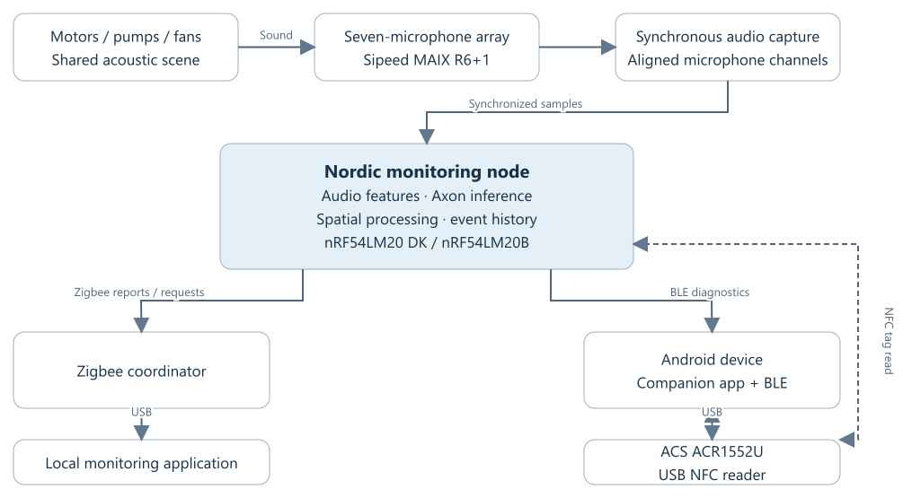
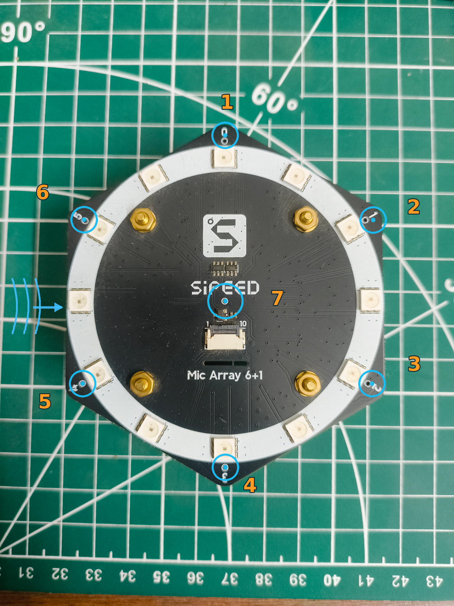
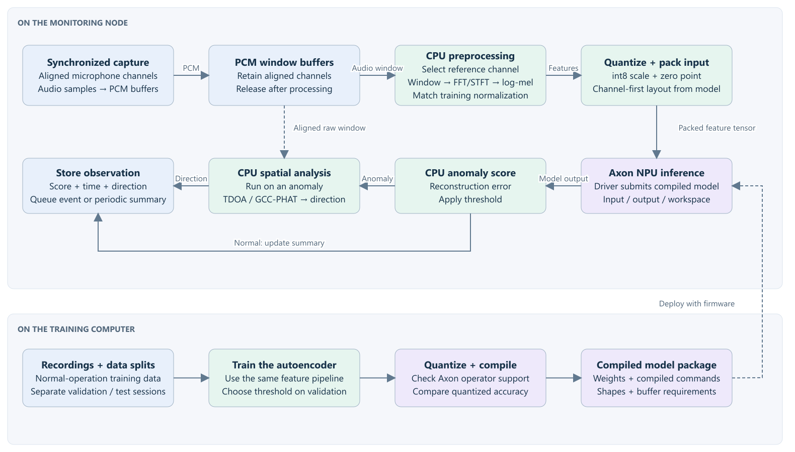
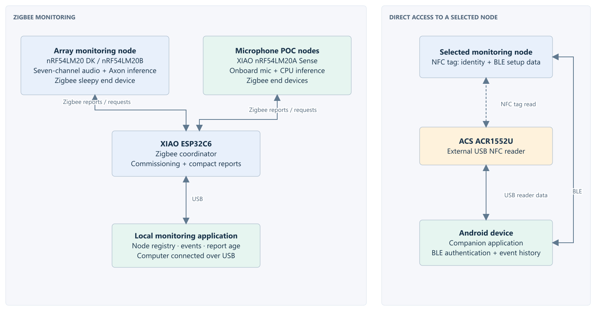
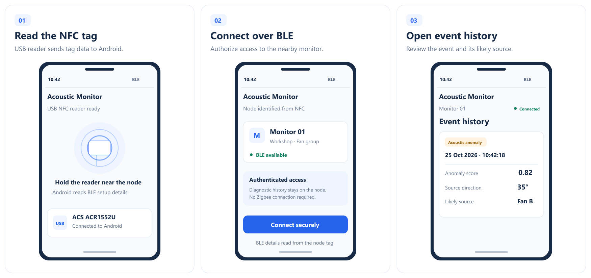
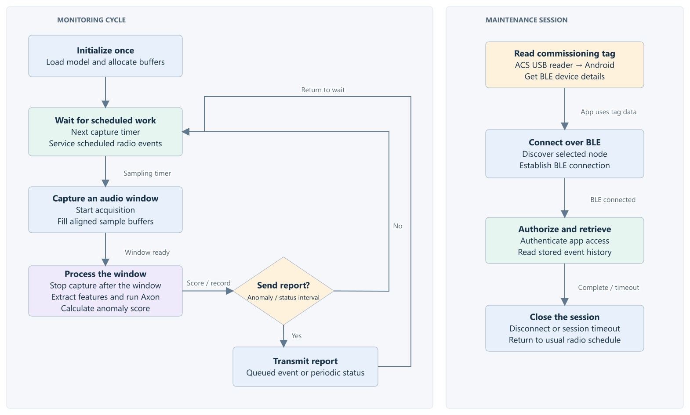

# Story

[Hackster Story editor](https://www.hackster.io/projects/0ce81d/edit#story) · [[Hackster/Basics|Basics]] · [[Hackster/Things|Things]]

Only the text between the article markers is intended for Hackster's Story section. Project overview: [[Overview]].

<!-- BEGIN HACKSTER ARTICLE -->

A motor that sounds different is worth paying attention to. Picking it out while a pump, two fans and everything else in the room are running is another matter. A microphone hears the whole room; an operator needs to know which machine to inspect.

I’m building a non-contact acoustic monitor for that situation. It will sit near rotating machinery, detect changes in operating sound and associate those changes with a source direction. The microphone array supplies spatial information, and an embedded model looks for departures from normal operation.

Vibration and temperature sensors already do useful work in condition monitoring. They usually require installation on individual machines. Here, I’m using sound to monitor from a nearby position, with the aim of helping an operator identify equipment that needs inspection before a small problem becomes a reason to replace it.

The monitoring node is built around the Nordic nRF54LM20 DK, targeting the nRF54LM20B and its Axon Neural Processing Unit (NPU). Audio processing and inference will run locally. Zigbee will deliver monitoring reports to the local application. During maintenance, a technician will connect directly over Bluetooth Low Energy (BLE) to inspect the node’s diagnostic history.

Each node will log event times, anomaly scores, operating conditions and source-direction estimates. Sending these results over Zigbee keeps network traffic low without streaming audio. The node will continue processing and logging if the monitoring application goes offline, retaining its records for later retrieval.

## Microphone Array and Audio Capture

I’m using the Sipeed MAIX R6+1 seven-microphone array to capture the same acoustic scene from different positions. The relative timing between those channels is essential: direction estimation depends on differences in the signals, not just seven recordings of roughly the same moment.

I’m testing the microphone capture interface on the Seeed Studio XIAO nRF54LM20A Sense while the DKs arrive. These tests will check channel alignment, sustained throughput and sample loss before I use the recordings for spatial analysis. A direction estimate is not useful if the capture system has introduced the delay it is trying to measure.

The XIAO’s built-in microphone also gives me a single-microphone baseline for feature extraction and CPU-based inference, and a way to evaluate a lower-cost monitoring node. The nRF54LM20B remains the target for Axon inference and the array-based system.

The array will also help isolate a machine’s sound from the surrounding noise. I’ll use delay-and-sum beamforming to compensate for the arrival-time differences between microphones for a selected direction, then combine the channels. Sound from that direction adds together coherently, while interference from other directions can be reduced. This directional noise suppression will give the anomaly model a clearer view of the selected machine. I’ll use GCC-PHAT to estimate the time differences between channels for source-direction analysis.

Reflections complicate this because the same sound reaches the array along more than one path. Nearby machines also share parts of the frequency spectrum, and machines in similar directions will be harder to separate. The output will therefore identify a likely direction or associate the event with a known machine position; the first implementation will not attempt precise room coordinates.

## Acoustic Anomaly Detection

Direction alone does not tell me whether a machine needs attention. I’ll train the model on recordings of normal machine operation. Based on how far each audio window deviates from that baseline, the system will assign an anomaly score during monitoring. This allows it to flag unfamiliar sounds without needing a labelled recording of every possible fault.

I’ll begin with spectral analysis and log-mel spectrograms, using FFT and short-time Fourier processing to examine how the signal changes over time. Compact autoencoders will provide the initial model baseline. Feature extraction and inference will be measured together, since a small network does not guarantee a small processing workload.

MIMII and DCASE machinery recordings will provide the first offline training and evaluation data. I’ll keep recordings for training, threshold selection and testing separate, and record the dataset version and operating conditions with the results. Physical recordings from the test setup will then show how the model behaves with this array and these machines.

To combine detection with direction estimation, I’ll compare two processing arrangements. The first uses the beamformed audio for anomaly detection, applying the same spatial processing to normal training recordings and evaluation recordings. The second runs the model on a reference microphone and retains the aligned multichannel window to estimate the source direction when a change is detected. The comparison will use correct-machine association and processing cost as well as angular error. Finding the loudest fan is not necessarily finding the abnormal one.

Training and quantization will run on a computer. I’ll deploy the quantized model to the Nordic device and check operator support, model size, RAM and inference time alongside its detection performance. Acquisition, feature extraction, storage and communication must all fit around that workload.

The NPU will receive a quantized feature tensor, not raw microphone samples. Firmware will apply the training-time normalization, quantize with the model’s scale and zero point, and pack the input in the layout required by the compiled model. For the autoencoder baseline, the CPU will compare the reconstructed features with the input to calculate the anomaly score. Buffers will remain valid until processing completes.

An anomaly score is a reason to inspect, not a diagnosis of bearing damage. Changes in speed, load and background noise also change the recording. Those normal variations will be included in testing so that a different operating condition does not automatically become a maintenance alert.

## Wireless Monitoring and Diagnostics

Once the node has an anomaly score and a source-direction estimate, it can report those results to the monitoring application. The XIAO ESP32C6 will coordinate the Zigbee network and connect to the monitoring computer over USB. Its firmware will form the network, commission nodes, receive reports and pass diagnostic requests to the selected node. The monitoring application will run locally without an internet dependency.

The Nordic monitoring nodes will operate as Zigbee Sleepy End Devices. They will send periodic operating summaries and report significant anomalies. Remote requests will be collected when a node polls its parent, so the polling interval will set the balance between response time and radio activity.

The application will maintain a node registry, cache reports and display their age. Timestamps, sequence numbers and timeouts will identify stale information without querying every node whenever the display refreshes. If reporting stops, the application will mark the node unavailable. A missing packet does not tell us whether the battery, hardware or radio link is responsible.

For on-site diagnostics, the nRF node exposes its identity and Bluetooth commissioning information as an NFC tag. The ACS ACR1552U reader connects to the Android device over USB. The companion application reads the tag through the reader, identifies the node and authenticates the BLE connection before retrieving its history. This maintenance path operates independently of Zigbee and does not require built-in NFC on Android.

The node will retain detailed event records and acoustic features for direct retrieval. I’ll test tag reading, device identification and BLE retrieval while acoustic processing and Zigbee reporting are active to check how they share processing and radio resources.

## Power Management

To manage the energy used by capture, processing and communication, I’ll run acoustic monitoring in timed windows. I’ll capture a window of audio, stop acquisition, extract its features and run inference. Once the result is processed, the CPU will wait for the next capture timer. Radio events will continue to run on the Zigbee and BLE schedules, and the Axon driver will return the NPU to its idle state between jobs.

An anomaly will queue an event report; otherwise, the node will accumulate statistics for its next status update. BLE diagnostics will run as a separate session and close on disconnect or timeout. The firmware will wait for capture and inference completion through events rather than poll for them. I’ll also disable unused peripherals, console output and LEDs when measuring consumption.

I’ll set the sampling interval by comparing energy use and missed events against continuous recordings. Measurements will include the microphone array and capture interface, including their idle current and settling time when capture restarts.

## Testing and Validation

I’ll use two low-voltage fans or motors running together for the first physical tests. One will run normally. For the other, I’ll use a worn fan or change the mounting stiffness to introduce a repeatable difference in its sound. I’ll record exactly what I changed, rather than attach a fault label based only on how unpleasant it sounds.

Each session will include the operating speed, source positions and background noise. I’ll move the sources and vary the noise so that the comparison does not depend on one convenient arrangement.

I’ll also record each machine separately as a reference, then compare the mixed and beamformed recordings with both machines running. Their spectra will help show whether the filtering reduces interference while preserving the changes associated with the abnormal condition. I’ll check whether that translates into fewer false alarms and better detection of the quieter abnormal source when the other machine is louder.

The same recordings and conditions will be evaluated with one microphone and the array. The array adds capture, memory, processing and energy costs, so I’ll measure whether it improves association with the abnormal source enough to justify them. Results will include detection performance, false alarms, direction error and correct-machine association.

Embedded measurements will cover model size, RAM, feature-extraction time, inference latency and total processing time per audio window.

Before connecting the acoustic detector to the network, I’ll use the available XIAO nRF54LM20A Sense boards to test the Zigbee firmware with the XIAO ESP32C6 coordinator. I’ll start with clearly labelled simulated measurements and check commissioning, periodic reports, anomaly alerts and diagnostic requests. Sequence numbers and timestamps will let me measure report delivery and request latency as I vary the reporting and parent-polling intervals. I’ll also restart individual nodes and the coordinator to check rejoining, stale-node detection and recovery of the application’s node registry.

For mesh testing, I’ll temporarily configure two Sense boards as continuously powered Zigbee routers and use the other two as sleepy end devices. The monitoring nodes will remain end devices; the router firmware is a separate test configuration. I’ll arrange the links so that reports travel through a router, verify the parent and routing information in the logs, then switch off one router and measure lost reports and the time taken to restore delivery through the remaining network. Moving the boards and introducing obstructions will show how delivery and recovery change with placement.

After those paths work, I’ll replace the simulated reports with real microphone observations and repeat the delivery and latency measurements while audio capture, feature extraction and BLE diagnostics are active. The final test will follow the complete sequence: a change at the machine, detection and source estimation at the node, a report in the monitoring application, and diagnostic retrieval beside the equipment. Measuring the network separately first will help distinguish communication failures from detector failures.

Power testing will separate acquisition, feature extraction, inference, Zigbee, BLE and idle consumption. Current measurements will be aligned with those processing stages so that the duty-cycle comparison includes the whole node, not only the NPU or radio.

## Farm and Field Monitoring

A future version will extend the same monitoring approach to irrigation pumps, farm motors and equipment spread across larger outdoor sites. That version will use LoRa for reports between field nodes and a gateway in place of the local Zigbee network. Acoustic processing will remain on each node, and BLE will remain the direct maintenance interface.

The field deployment will need its own enclosure, power budget and communication tests.

## References

- [Nordic nRF54LM20 DK](https://www.nordicsemi.com/Products/Development-hardware/nRF54LM20-DK) and [nRF54LM20A/B specification](https://docs.nordicsemi.com/r/bundle/ps_nrf54lm20a/page/keyfeatures_html5.html) — development platform and A/B hardware differences.
- [XIAO nRF54LM20A Sense documentation](https://github.com/Seeed-Studio/wiki-documents/blob/docusaurus-version/sites/en/docs/Sensor/SeeedStudio_XIAO/SeeedStudio_XIAO_nRF54LM20A-Sense/XIAO_nRF54LM20A-Sense_Getting_Started.md) — onboard microphone and board peripherals.
- [Nordic Zigbee R23 architectures](https://nrfconnectdocs.nordicsemi.com/addons/zigbee-r23/latest/architectures.html) and [router template](https://nrfconnectdocs.nordicsemi.com/addons/ncs-zigbee/latest/samples/template/README.html) — end-device/router designs and the starting point for router test firmware; XIAO board integration will be checked during development.
- [Sipeed R6+1 microphone-array datasheet](https://dl.sipeed.com/MAIX/HDK/Sipeed-R6%2B1_MicArray/Specifications/Sipeed%20R6%2B1%20Microphone%20Array%20Datasheet%20V1.0.pdf) — array hardware reference.
- [Acoustic beamforming using a microphone array](https://www.mathworks.com/help/audio/ug/acoustic-beamforming-using-a-microphone-array.html) — delay compensation, directional interference suppression and beamformer evaluation; the example uses speech, while this build will evaluate machinery sounds.
- [ACS ACR1552U technical specification](https://www.acs.com.hk/download-manual/13248/TSP-ACR1552U-1.04.pdf) — USB reader capabilities and Android platform support.
- [Nordic NFC pairing sample](https://nrfconnectdocs.nordicsemi.com/ncs/latest/nrf/samples/bluetooth/peripheral_nfc_pairing/README.html) — NFC tag-side Bluetooth handover reference; the Android application will handle the external-reader workflow.
- [Axon model compiler](https://nrfconnectdocs.nordicsemi.com/addons/addon-edge-ai/latest/axon_compiler/Axon_npu_tflite_compiler.html) — quantized-model conversion and compatibility checks.
- [Axon inference integration](https://nrfconnectdocs.nordicsemi.com/addons/addon-edge-ai/latest/integrations/axon.html) — model input layout, buffers and inference completion.
- [Axon supported operators](https://nrfconnectdocs.nordicsemi.com/addons/addon-edge-ai/latest/axon_compiler/supported_operators.html) — model compatibility and quantization guidance.
- [Axon low-power sample](https://nrfconnectdocs.nordicsemi.com/addons/addon-edge-ai/latest/samples/axon/axon_low_power/README.html) — inference scheduling and power profiling.
- [MIMII dataset](https://zenodo.org/records/3384388) and [DCASE 2025 Task 2](https://dcase.community/challenge2025/task-first-shot-unsupervised-anomalous-sound-detection-for-machine-condition-monitoring) — machinery-sound data and evaluation references.

## Photo Credits

Photographs used under the [Pexels License](https://www.pexels.com/license/):

- Cover: [Industrial Pumps at Dubai Power Plant](https://www.pexels.com/photo/industrial-pumps-at-dubai-power-plant-35645884/) by Mumtaz Niazi.
- Industrial motor room: [Gray and Red Industrial Machine](https://www.pexels.com/photo/gray-and-red-industrial-machine-2569839/) by Magda Ehlers.

<!-- END HACKSTER ARTICLE -->

## Draft asset notes

- After recording, add normal and abnormal spectrograms with identical axes and colour scales to Acoustic Anomaly Detection. Include the machine condition, speed and microphone position in the caption. Use the actual recordings from the tests.
- Add a top-down test layout to Testing and Validation showing fan A, fan B, the array orientation, angles and distances. Follow it with a photograph once assembled. Use the same labels in the recording notes and result plots.
